<div align="center">

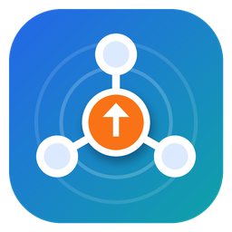

# LAN Share Hub

**ให้เพื่อนในวง LAN เทสเว็บที่คุณรันบน localhost ได้ทันที · แชร์ไฟล์ · เปิดเว็บ static — ไม่ต้องแก้ config ไม่ต้องขึ้นอินเทอร์เน็ต**<br>
**Let friends on your LAN test the app you run on localhost · share folders · host static sites — no config changes, nothing goes online**


-000000?logo=apple&logoColor=white)


[ภาษาไทย](#-ภาษาไทย) · [English](#-english)

<br>

<a href="https://github.com/madara1150/lan-share-hub/releases/latest/download/LANShareHub-Windows-Setup.exe"></a>
&nbsp;
<a href="https://github.com/madara1150/lan-share-hub/releases/latest/download/LANShareHub-macOS.dmg"></a>

<sub>Windows แบบไม่ต้องติดตั้ง / Portable: <a href="https://github.com/madara1150/lan-share-hub/releases/latest/download/LANShareHub-Windows-Portable.zip">LANShareHub-Windows-Portable.zip</a> · ทุกเวอร์ชัน / All versions: <a href="https://github.com/madara1150/lan-share-hub/releases">Releases</a></sub>

<br><br>

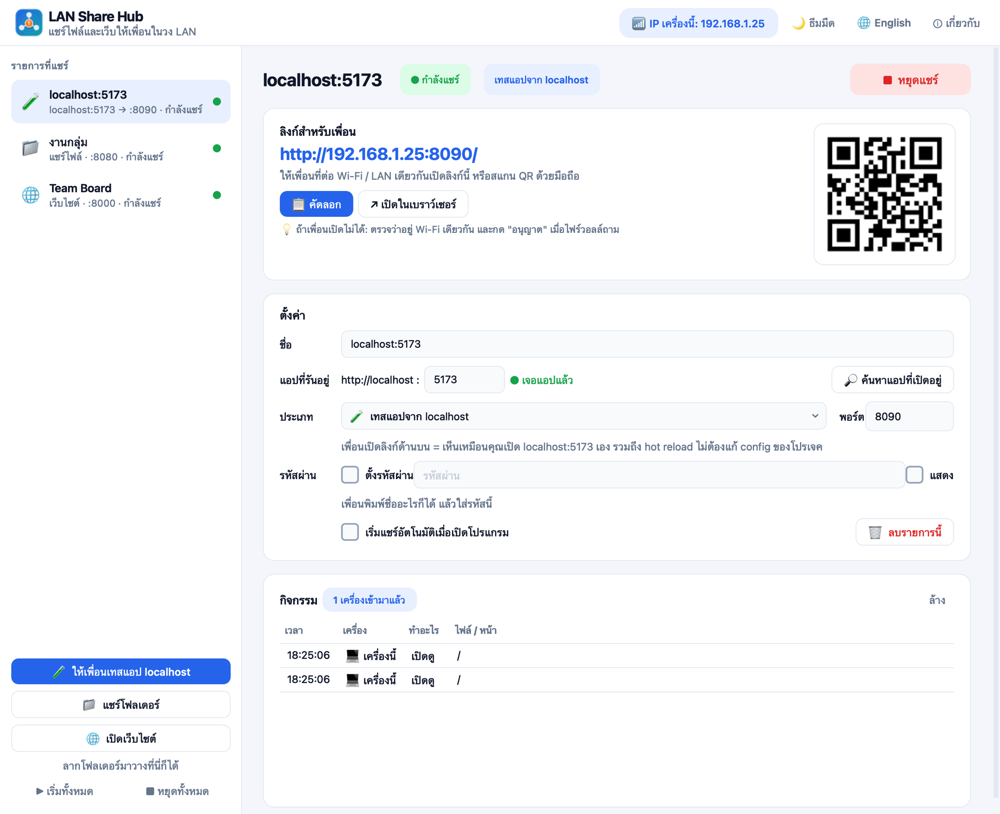

</div>

---

## 🇹🇭 ภาษาไทย

### ✨ ทำอะไรได้บ้าง

| ✨ ฟีเจอร์ | คำอธิบาย |
|---|---|
| 🧪 **ให้เพื่อนเทสแอป localhost** | กำลังรัน `npm run dev` อยู่ที่ `localhost:3000`? กดปุ่มเดียว เพื่อนที่ต่อ Wi-Fi เดียวกันก็เปิดลิงก์ `http://<IP เครื่องคุณ>:8090` ได้เลย ใช้กับ Next.js, Vite, React, Vue, Angular, Django, Laravel ฯลฯ |
| 🔁 **Hot reload ใช้ได้** | ส่งต่อ WebSocket ด้วย แก้โค้ดแล้วหน้าจอเพื่อนรีเฟรชตามทันที |
| 🛠️ **ไม่ต้องแก้ config โปรเจค** | dev server ไม่ต้องเปิด `--host 0.0.0.0` โปรแกรมแปลง Host/Origin ให้เป็น `localhost` ให้อัตโนมัติ dev server จึงไม่บล็อกเพื่อน |
| 🔎 **หาแอปที่เปิดอยู่ให้เอง** | สแกนพอร์ตที่ใช้บ่อย (3000, 5173, 4200, 8000 …) และบอกสถานะว่าแอปเปิดอยู่หรือยัง ถ้า dev server ปิดอยู่ เพื่อนจะเห็นหน้า "แอปยังไม่ได้เปิด" ที่รีเฟรชตัวเองจนกว่าจะกลับมา |
| 📁 **แชร์โฟลเดอร์** | เพื่อนเปิดดูและดาวน์โหลดไฟล์ผ่านเบราว์เซอร์ หน้าเว็บสวยและใช้บนมือถือได้ ค้นหาไฟล์ได้ ดูวิดีโอแบบเลื่อนได้ |
| ⬆️ **ให้เพื่อนอัปโหลดได้ (ถ้าเปิดเอง)** | ปิดไว้เป็นค่าเริ่มต้น เมื่อเปิดแล้วไฟล์ที่อัปโหลดจะไม่เขียนทับไฟล์เดิม ถ้าชื่อซ้ำจะตั้งชื่อใหม่ให้ |
| 🌐 **เปิดเว็บ static** | เลือกโฟลเดอร์ที่มี `index.html` (เช่น `dist/`, `build/`) เพื่อเปิดให้เพื่อนดูได้ทันที |
| 📱 **QR code** | เพื่อนสแกนด้วยมือถือได้เลย ไม่ต้องพิมพ์ IP |
| 🔒 **ตั้งรหัสผ่านได้** | ตั้งได้แยกทุกรายการ รหัสนี้ไม่ถูกส่งต่อไปยังแอปของคุณ |
| 👀 **ดูว่าใครเข้ามา** | แสดงเครื่องที่เข้ามา หน้าที่เปิด และไฟล์ที่ดาวน์โหลด/อัปโหลดแบบสด |
| 🗂️ **หลายรายการพร้อมกัน** | รันได้หลายแอปหลายโฟลเดอร์พร้อมกัน แต่ละรายการใช้พอร์ตของตัวเอง และตั้งให้เริ่มอัตโนมัติตอนเปิดโปรแกรมได้ |
| 🌗 **สวยและใช้ง่าย** | ธีมสว่าง/มืด · ภาษาไทย/อังกฤษ · ลากโฟลเดอร์มาวางเพื่อแชร์ได้เลย |

<p align="center">
  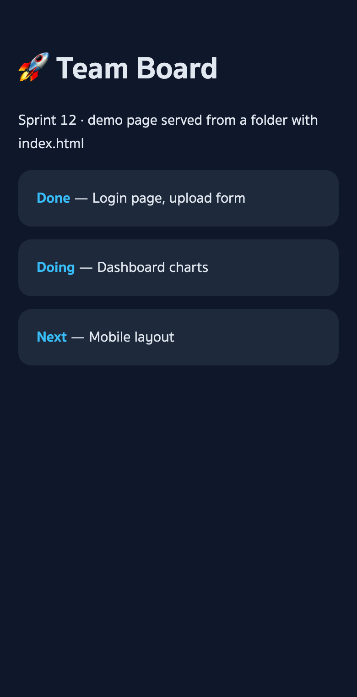
  &nbsp;&nbsp;
  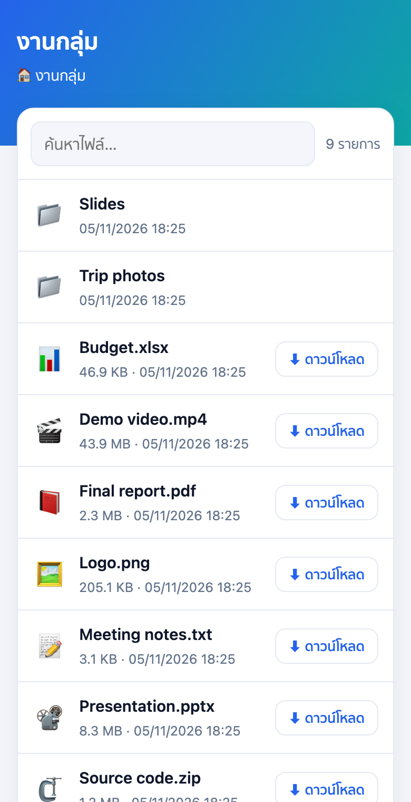
  <br><br>
  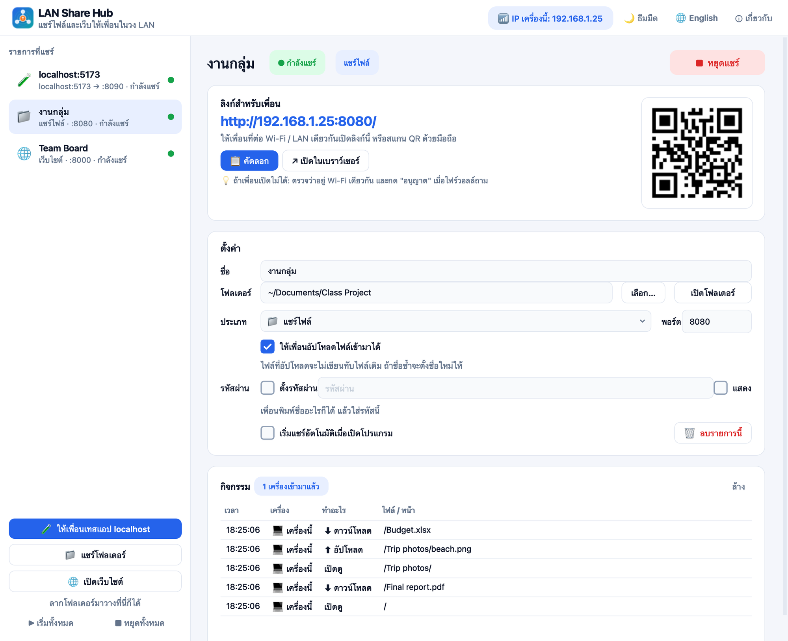
  <br><br>
  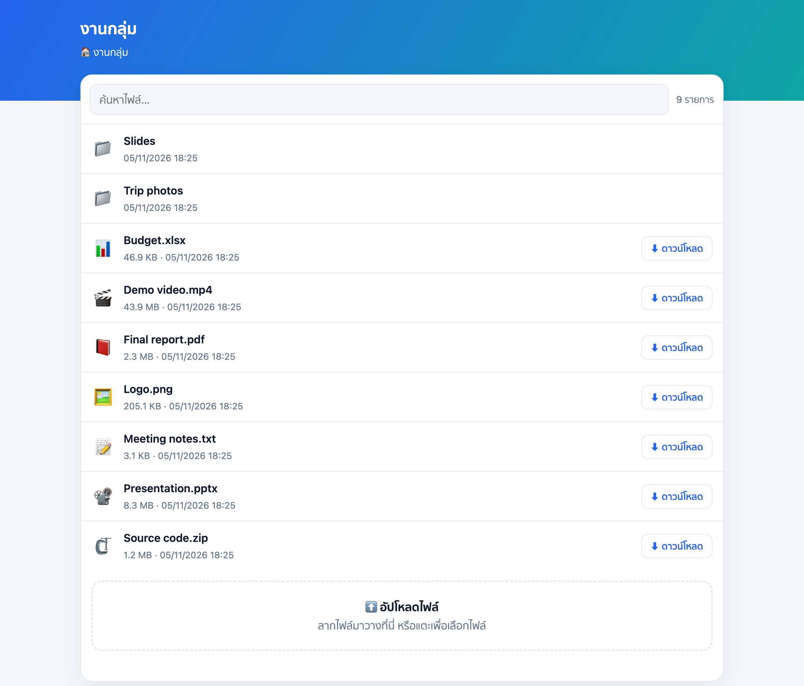
  <br><br>
  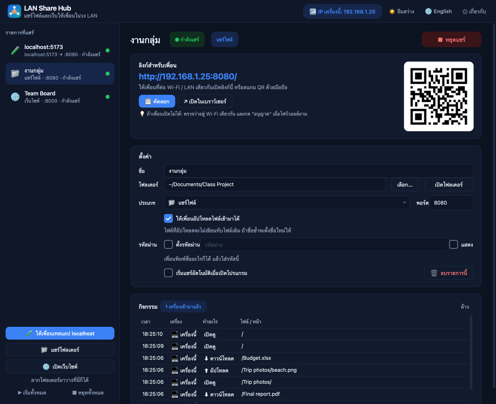
</p>

---

### 💾 ดาวน์โหลดและติดตั้ง

- **Windows 10/11**: ดาวน์โหลด [LANShareHub-Windows-Setup.exe](https://github.com/madara1150/lan-share-hub/releases/latest/download/LANShareHub-Windows-Setup.exe) แล้วติดตั้ง หรือใช้ [แบบ Portable](https://github.com/madara1150/lan-share-hub/releases/latest/download/LANShareHub-Windows-Portable.zip) (แตก zip แล้วเปิด `LANShareHub.exe`)
- **macOS 11+**: ดาวน์โหลด [LANShareHub-macOS.dmg](https://github.com/madara1150/lan-share-hub/releases/latest/download/LANShareHub-macOS.dmg) เปิดไฟล์ แล้วลาก **LAN Share Hub** ไปไว้ที่ Applications

---

### 🚀 วิธีใช้

**ให้เพื่อนเทสแอปที่รันบน localhost**

1. รัน dev server ตามปกติ เช่น `npm run dev`
2. เปิด LAN Share Hub แล้วกด **🧪 ให้เพื่อนเทสแอป localhost** (โปรแกรมจะหาพอร์ตของแอปให้ หรือกด **ค้นหาแอปที่เปิดอยู่**)
3. กด **▶ เริ่มแชร์**
4. ส่งลิงก์ (ปุ่ม **คัดลอก**) หรือให้เพื่อนสแกน QR code ซึ่งเพื่อนต้องต่อ Wi-Fi / LAN เดียวกับคุณ

**แชร์ไฟล์หรือเว็บ static**

1. กด **📁 แชร์โฟลเดอร์** หรือ **🌐 เปิดเว็บไซต์** แล้วเลือกโฟลเดอร์ (หรือลากโฟลเดอร์มาวางในหน้าต่าง)
2. ถ้าจะให้เพื่อนส่งไฟล์มาให้ ติ๊ก **ให้เพื่อนอัปโหลดไฟล์เข้ามาได้**
3. กด **▶ เริ่มแชร์** แล้วส่งลิงก์ให้เพื่อน

---

### ❓ คำถามที่พบบ่อย / แก้ปัญหา

<details><summary><b>เพื่อนเปิดลิงก์ไม่ได้</b></summary>

- ตรวจว่าเพื่อนต่อ Wi-Fi / LAN **เดียวกัน** (Wi-Fi สาธารณะหรือ Wi-Fi แขกบางที่จะกั้นไม่ให้เครื่องคุยกัน)
- ตอนเริ่มแชร์ครั้งแรก ถ้าไฟร์วอลล์ถาม ให้กด **อนุญาต (Allow)**
  - Windows: เลือก **Private networks**
  - macOS: System Settings → Network → Firewall → อนุญาต LAN Share Hub · และ Privacy & Security → **Local Network**
- ถ้าเครื่องมีหลายเครือข่าย (เช่น VPN) โปรแกรมจะแสดง IP อื่นไว้ใต้ลิงก์ ให้ลองใช้ IP นั้น
</details>

<details><summary><b>หน้าเว็บขึ้นว่า "แอปยังไม่ได้เปิด"</b></summary>

แปลว่าไม่มีอะไรรันที่พอร์ตที่ตั้งไว้ ให้รัน dev server ก่อน หรือแก้ช่อง **แอปที่รันอยู่** ให้ตรงพอร์ต หน้านี้จะรีเฟรชเองทุก 4 วินาที
</details>

<details><summary><b>ต้องตั้ง dev server ให้ฟัง 0.0.0.0 ไหม</b></summary>

ไม่ต้อง โปรแกรมต่อเข้า `localhost` ของเครื่องคุณเอง และส่ง Host/Origin เป็น `localhost:<พอร์ต>` dev server จึงเห็นเหมือนคุณเปิดเอง (ใช้ได้กับทั้ง IPv4 และ IPv6)
</details>

<details><summary><b>macOS บอกว่า "ไม่สามารถเปิดได้เพราะไม่ทราบผู้พัฒนา"</b></summary>

คลิกขวาที่แอป → **Open** → **Open** อีกครั้ง (ทำครั้งเดียว) หรือไปที่ System Settings → Privacy & Security → **Open Anyway**
</details>

<details><summary><b>Windows SmartScreen เตือน</b></summary>

กด **More info** → **Run anyway** ที่ขึ้นเตือนเพราะโปรแกรมยังไม่มีใบรับรองแบบเสียเงิน
</details>

<details><summary><b>ปลอดภัยไหม</b></summary>

ทุกอย่างอยู่ในวง LAN ไม่มีอะไรขึ้นอินเทอร์เน็ต เพื่อนเปิดได้เฉพาะโฟลเดอร์ที่คุณเลือก (ไฟล์ซ่อนและ symlink ที่ชี้ออกนอกโฟลเดอร์จะเปิดไม่ได้) การอัปโหลดปิดไว้เป็นค่าเริ่มต้น และตั้งรหัสผ่านได้ · ระวังเรื่อง Wi-Fi สาธารณะ เพราะคนอื่นในเครือข่ายเดียวกันก็เปิดลิงก์ได้เหมือนกัน ควรตั้งรหัสผ่านไว้
</details>

---

### 🛠️ Build เอง (สำหรับนักพัฒนา)

```bash
python3 -m venv .venv
.venv/bin/pip install -r requirements-dev.txt
.venv/bin/python main.py          # เปิดโปรแกรม
.venv/bin/python -m pytest        # รันเทสต์
```

- macOS: `./build_mac.sh` → `dist/LANShareHub-macOS.dmg`
- Windows: `build_windows.bat` → `dist\LANShareHub-Windows-Setup.exe` และ `dist\LANShareHub-Windows-Portable.zip` (ต้องมี [Inno Setup 6](https://jrsoftware.org/isdl.php) เพื่อสร้างตัวติดตั้ง)
- ภาพหน้าจอใน README: `.venv/bin/python tools/screenshots.py` (รันแอปจริงและใช้ Google Chrome แบบ headless)

---

### 📄 License

[MIT](LICENSE) © 2026 Tanathip

<br>

---

## 🇬🇧 English

### ✨ What it does

| ✨ Feature | Description |
|---|---|
| 🧪 **Let friends test your localhost app** | Running `npm run dev` on `localhost:3000`? Press one button and friends on the same Wi-Fi open `http://<your IP>:8090`. Works with Next.js, Vite, React, Vue, Angular, Django, Laravel and more |
| 🔁 **Hot reload works** | WebSockets are forwarded too, so friends' screens update as you edit code |
| 🛠️ **No project config changes** | No need for `--host 0.0.0.0`: Host/Origin are rewritten to `localhost`, so your dev server doesn't block friends |
| 🔎 **Finds your running apps** | Scans the usual ports (3000, 5173, 4200, 8000 …) and shows whether your app is up. If the dev server is down, friends see an "app isn't running" page that refreshes itself until it's back |
| 📁 **Share folders** | Friends browse and download files from a clean, mobile-friendly page with search and video seeking |
| ⬆️ **Uploads, only if you allow them** | Off by default. When on, uploads never overwrite a file — duplicates get a new name |
| 🌐 **Host static sites** | Pick a folder with `index.html` (e.g. `dist/`, `build/`) and it's live |
| 📱 **QR code** | Friends scan it with their phone — no typing IP addresses |
| 🔒 **Password protection** | Per share. The password is never passed on to your app |
| 👀 **See who's connected** | Live list of devices, pages opened and files downloaded / uploaded |
| 🗂️ **Many at once** | Run several apps and folders at the same time, each on its own port, and auto-start them when the app opens |
| 🌗 **Pleasant to use** | Light / dark theme · Thai / English · drop a folder onto the window to share it |

<p align="center">
  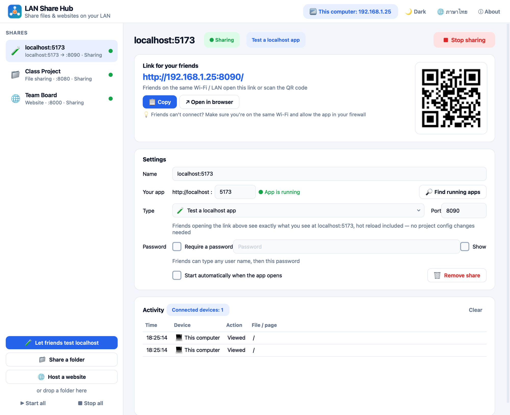
  <br><br>
  
  &nbsp;&nbsp;
  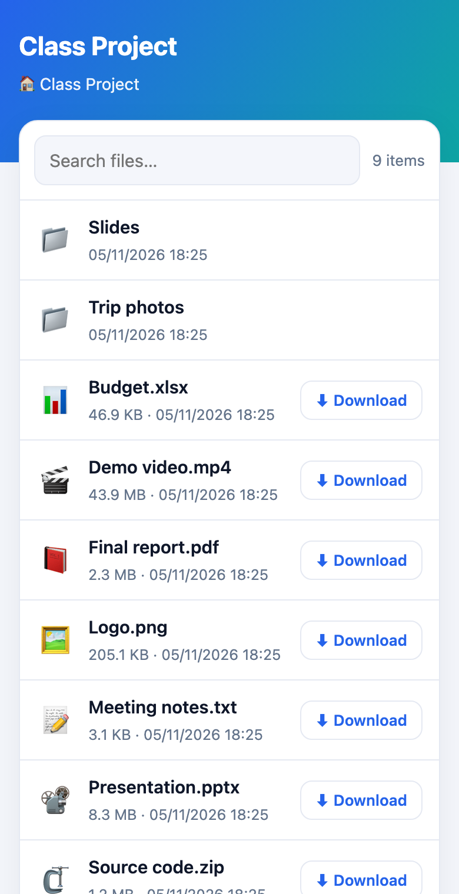
  <br><br>
  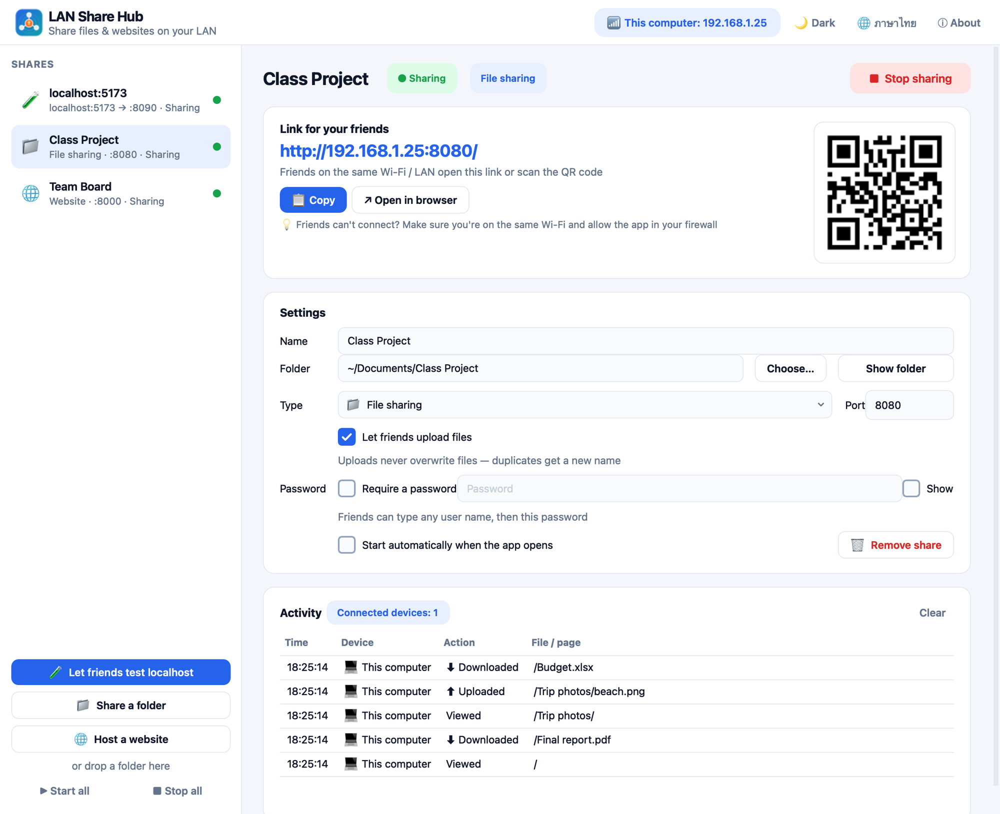
  <br><br>
  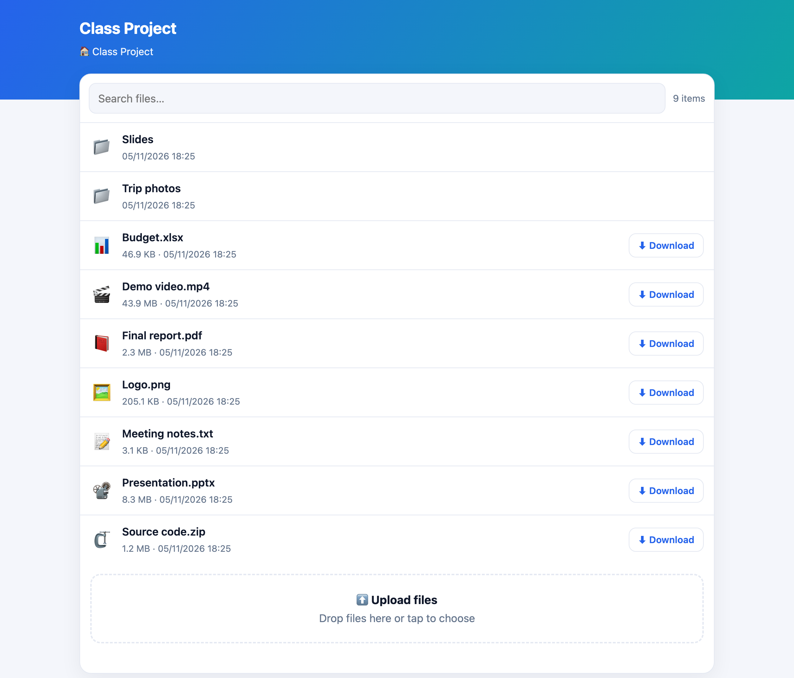
</p>

---

### 💾 Download & install

- **Windows 10/11**: download [LANShareHub-Windows-Setup.exe](https://github.com/madara1150/lan-share-hub/releases/latest/download/LANShareHub-Windows-Setup.exe) and install it, or use the [portable zip](https://github.com/madara1150/lan-share-hub/releases/latest/download/LANShareHub-Windows-Portable.zip) (unzip and run `LANShareHub.exe`)
- **macOS 11+**: download [LANShareHub-macOS.dmg](https://github.com/madara1150/lan-share-hub/releases/latest/download/LANShareHub-macOS.dmg), open it and drag **LAN Share Hub** to Applications

---

### 🚀 How to use

**Let friends test the app you run on localhost**

1. Start your dev server as usual, e.g. `npm run dev`
2. Open LAN Share Hub and press **🧪 Let friends test localhost** (it picks your app's port, or press **Find running apps**)
3. Press **▶ Start sharing**
4. Send the link (**Copy**) or let friends scan the QR code — they must be on the same Wi-Fi / LAN

**Share files or a static site**

1. Press **📁 Share a folder** or **🌐 Host a website** and pick a folder (or drop one onto the window)
2. To let friends send you files, tick **Let friends upload files**
3. Press **▶ Start sharing** and send the link

---

### ❓ FAQ / troubleshooting

<details><summary><b>Friends can't open the link</b></summary>

- Make sure they're on the **same** Wi-Fi / LAN (public and guest Wi-Fi often isolate devices)
- When the firewall asks the first time you start sharing, choose **Allow**
  - Windows: tick **Private networks**
  - macOS: System Settings → Network → Firewall → allow LAN Share Hub, and Privacy & Security → **Local Network**
- With several networks (e.g. a VPN), other addresses are listed under the link — try those
</details>

<details><summary><b>The page says "The app isn't running"</b></summary>

Nothing is listening on the port you set. Start your dev server or fix the **Your app** port. The page refreshes itself every 4 seconds.
</details>

<details><summary><b>Do I need to bind my dev server to 0.0.0.0?</b></summary>

No. LAN Share Hub connects to `localhost` on your computer and sends Host/Origin as `localhost:<port>`, so the dev server sees the same thing as when you open it yourself (IPv4 and IPv6 both work).
</details>

<details><summary><b>macOS says the app is from an unidentified developer</b></summary>

Right-click the app → **Open** → **Open** (once), or System Settings → Privacy & Security → **Open Anyway**.
</details>

<details><summary><b>Windows SmartScreen warning</b></summary>

Click **More info** → **Run anyway**. It appears because the app isn't signed with a paid certificate.
</details>

<details><summary><b>Is it safe?</b></summary>

Everything stays on your LAN; nothing goes to the internet. Friends can only reach the folder you picked (hidden files and symlinks pointing outside it are blocked), uploads are off by default, and you can set a password. On public Wi-Fi anyone on that network can open the link too, so set a password there.
</details>

---

### 🛠️ Build it yourself (developers)

```bash
python3 -m venv .venv
.venv/bin/pip install -r requirements-dev.txt
.venv/bin/python main.py          # run the app
.venv/bin/python -m pytest        # run the tests
```

- macOS: `./build_mac.sh` → `dist/LANShareHub-macOS.dmg`
- Windows: `build_windows.bat` → `dist\LANShareHub-Windows-Setup.exe` and `dist\LANShareHub-Windows-Portable.zip` (needs [Inno Setup 6](https://jrsoftware.org/isdl.php) for the installer)
- README screenshots: `.venv/bin/python tools/screenshots.py` (drives the real app and headless Google Chrome)

---

### 📄 License

[MIT](LICENSE) © 2026 Tanathip
